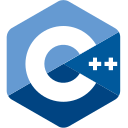
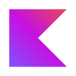

<table>
  <tr>
    <td><b>Education</b></td>
    <td>
    &nbsp;YANDEX&nbsp;Lyceum&nbsp;&nbsp;
    &nbsp;IT&nbsp;SAMSUNG&nbsp;School&nbsp;&nbsp;
    &nbsp;NEIMARK&nbsp;IT&nbsp;Academy
    </td>
  </tr>
  <tr>
    <td><b>Languages</b></td>
    <td>
    &nbsp;Python&nbsp;&nbsp;
    &nbsp;C++&nbsp;&nbsp;
    &nbsp;Go&nbsp;&nbsp;
    &nbsp;Kotlin&nbsp;&nbsp;
    &nbsp;Java
    </td>
  </tr>
  <tr>
    <td><i>Familiar with</i></td>
    <td>
    &nbsp;JavaScript&nbsp;&nbsp;
    &nbsp;TypeScript&nbsp;&nbsp;
    &nbsp;PHP&nbsp;&nbsp;
    &nbsp;C&nbsp;&nbsp;
    &nbsp;Swift
    </td>
  </tr>
  <tr>
    <td><b>Frameworks &amp; Libraries</b></td>
    <td>
    &nbsp;Next.js&nbsp;&nbsp;
    &nbsp;React&nbsp;&nbsp;
    &nbsp;Tailwind&nbsp;CSS&nbsp;&nbsp;
    &nbsp;Fiber 
    &nbsp;Android&nbsp;SDK&nbsp;&nbsp;
    &nbsp;Aiogram&nbsp;&nbsp;
    &nbsp;PyGame
    </td>
  </tr>
  <tr>
    <td><b>Databases &amp; ORM</b></td>
    <td>
    &nbsp;SQL&nbsp;&nbsp;
    &nbsp;PostgreSQL&nbsp;&nbsp;
    &nbsp;SQLite&nbsp;&nbsp;
    &nbsp;SQLAlchemy
    </td>
  </tr>
  <tr>
    <td><b>Tools</b></td>
    <td>
    &nbsp;Git&nbsp;&nbsp;
    &nbsp;GitHub&nbsp;&nbsp;
    &nbsp;GitLab&nbsp;&nbsp;
    &nbsp;Linux 
    &nbsp;Docker&nbsp;&nbsp;
    &nbsp;VS&nbsp;Code&nbsp;&nbsp;
    &nbsp;IntelliJ&nbsp;IDEA
    </td>
  </tr>
</table>

 

&nbsp;
&nbsp;

